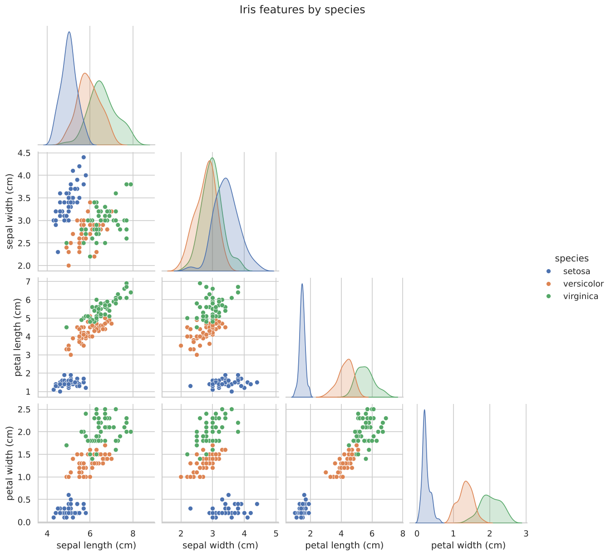
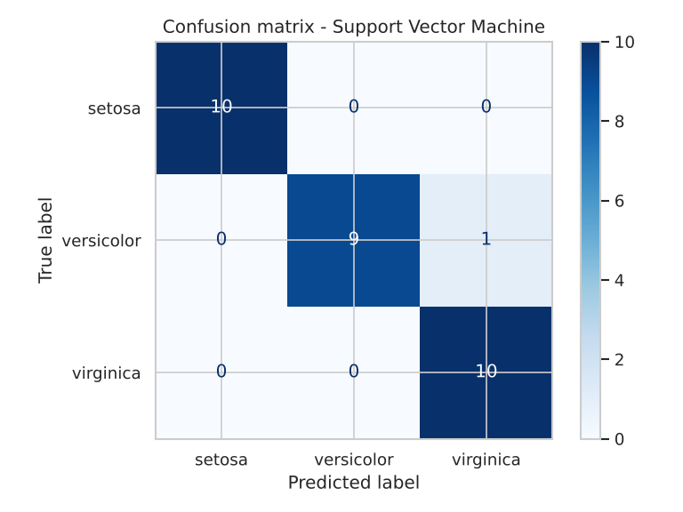
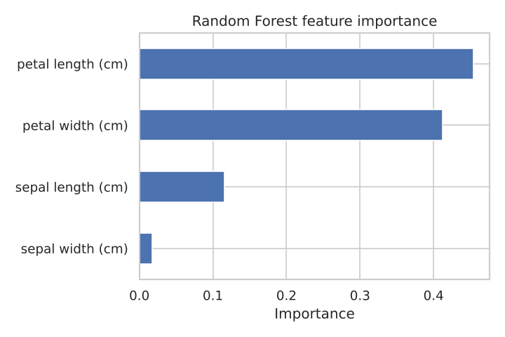

# CodeAlpha_IrisFlowerClassification

**CodeAlpha Data Science Internship – Task 1**
Author: Rinae Mathaulula

Classifying Iris flowers into *setosa*, *versicolor* and *virginica* from four measurements: sepal length, sepal width, petal length and petal width.

## Dataset
The classic Iris dataset (150 flowers, 50 per species, no missing values), loaded directly from scikit-learn with `load_iris()`, so no download is needed.

## What the project does
1. **Explores the data** – class balance, per-species averages, a pairplot and a correlation heatmap.
2. **Splits the data** – 80% training / 20% test, stratified so each species is equally represented.
3. **Compares five classifiers** with 5-fold cross-validation: Logistic Regression, K-Nearest Neighbours, Support Vector Machine, Decision Tree and Random Forest.
4. **Evaluates the best model** on the unseen test set (accuracy, precision, recall, F1, confusion matrix).
5. **Explains the model** – Random Forest feature importance shows which measurements matter.
6. **Predicts new flowers** from raw measurements.

## Results

| Model | CV mean accuracy | Test accuracy |
|---|---|---|
| **Support Vector Machine** | **0.967** | **0.967** |
| Logistic Regression | 0.958 | 0.933 |
| K-Nearest Neighbours | 0.958 | 0.933 |
| Decision Tree | 0.950 | 0.933 |
| Random Forest | 0.950 | 0.900 |

The SVM classified 29 of 30 test flowers correctly. Setosa is perfectly separable; the only error was one versicolor predicted as virginica — these two species overlap in measurement space.

**Key insight:** petal length and petal width carry most of the predictive power (≈87% of Random Forest importance combined); sepal width contributes almost nothing.





## How to run
```bash
pip install -r requirements.txt
python iris_classification.py
```
Plots are saved as PNG files and the model comparison to `model_comparison.csv`.

## Tools
Python, Pandas, NumPy, Scikit-learn, Matplotlib, Seaborn
