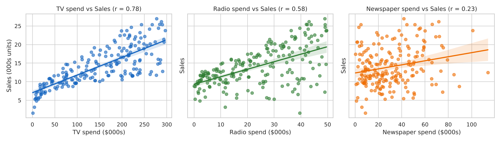
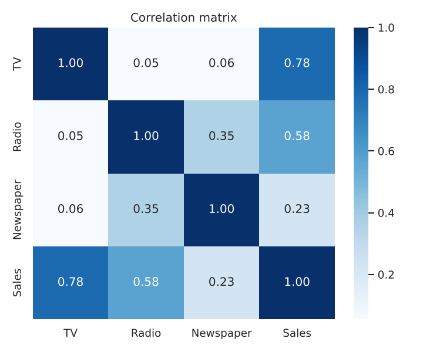
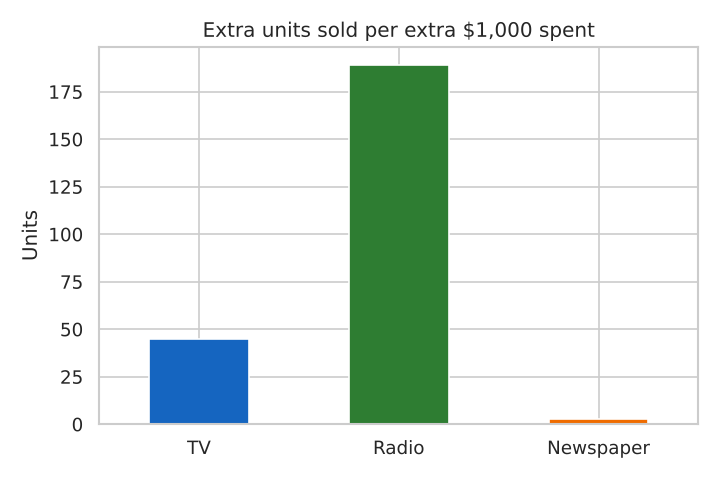
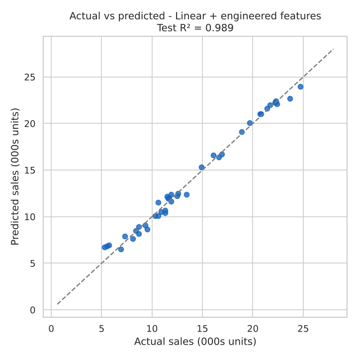
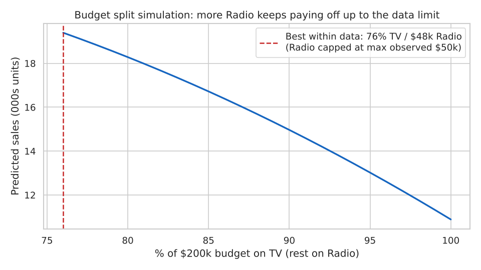

# CodeAlpha_SalesPrediction

**CodeAlpha Data Science Internship – Task 4**
Author: Rinae Mathaulula

This project predicts product sales from advertising spend on **TV, Radio and Newspaper**. It also analyses how changing the advertising budget affects sales, to guide marketing decisions.

## Dataset (`Advertising.csv`)
The dataset has 200 markets. For each market it records advertising spend on TV, Radio and Newspaper (in thousands of dollars) and the Sales achieved (in thousands of units).

## Workflow
1. **Cleaning** – dropped the row-index column and checked for missing values (none), duplicates (none) and outliers. Two mild Newspaper outliers were kept because they are real spend values.
2. **Exploration** – plotted each channel against sales and built a correlation matrix.
3. **Feature engineering**
   - `TV_x_Radio`: captures *synergy*, meaning radio makes TV advertising work better and vice versa.
   - `sqrt_TV`: captures *diminishing returns*, meaning each extra TV dollar adds less than the last.
4. **Modelling** – compared linear regression (three versions), Random Forest and Gradient Boosting. Each model was scored with 5-fold cross-validation and an 80/20 train/test split.
5. **What-if analysis** – simulated different budget splits and spend increases using the best model.

## Results

| Model | CV R² | Test R² | Test MAE (000s units) |
|---|---|---|---|
| **Linear + engineered features** | **0.981** | **0.989** | **0.49** |
| Gradient Boosting | 0.967 | 0.983 | 0.62 |
| Random Forest | 0.966 | 0.983 | 0.61 |
| Linear (TV, Radio) | 0.874 | 0.901 | 1.44 |
| Linear (TV, Radio, Newspaper) | 0.870 | 0.899 | 1.46 |

The best model is a simple linear regression with the two engineered features. It explains **98.9%** of the variation in sales and is off by only about 490 units on average. It outperforms the tree models while staying fully interpretable. Removing Newspaper made no difference to accuracy.

## How advertising affects sales
| Channel | Correlation with sales | Extra units per extra $1,000 (linear model) |
|---|---|---|
| TV | 0.78 | ≈ 45 |
| Radio | 0.58 | ≈ 189 |
| Newspaper | 0.23 | ≈ 3 (not significant) |

The best model was also used to estimate what one extra $10k would do, starting from the average campaign (TV $147k, Radio $23k, Newspaper $31k):
- **+$10k on Radio → about +1,900 units**
- +$10k on TV → about +420 units
- +$10k on Newspaper → no measurable change

## Business insights
1. **Radio is the best-value channel at current spend levels.** Each extra dollar there returns roughly 4–5× what TV does.
2. **TV and Radio work best together.** The interaction term is what lifts accuracy from 90% to 99%, so campaigns should combine the two rather than rely on one.
3. **TV still drives volume but shows diminishing returns.** It is the largest driver of sales overall, yet past a point extra TV spend adds progressively less.
4. **Newspaper spend could be cut or moved.** Its apparent link to sales comes from being bought alongside Radio, and it adds nothing once TV and Radio are accounted for.
5. **Rebalance the budget toward Radio.** With a $200k budget, the model predicts about **19.4k units** for a 76% TV / 24% Radio split. The average campaign, which spends a similar total, gets about 14k. This is the most Radio spend the data contains (~$50k), so going further should be tested with a small experiment rather than taken from the model.







## How to run
```bash
pip install -r requirements.txt
python sales_prediction.py
```

## Tools
Python, Pandas, NumPy, Scikit-learn, Matplotlib, Seaborn
