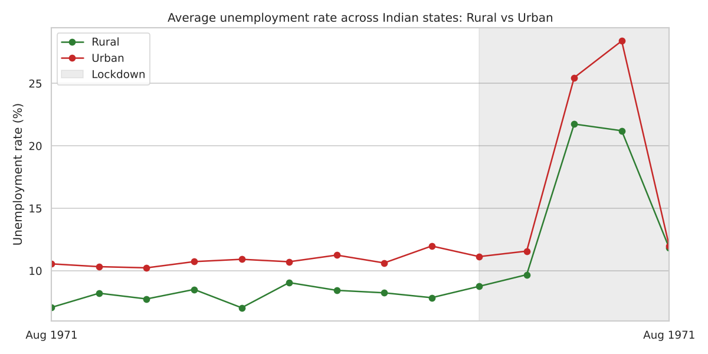
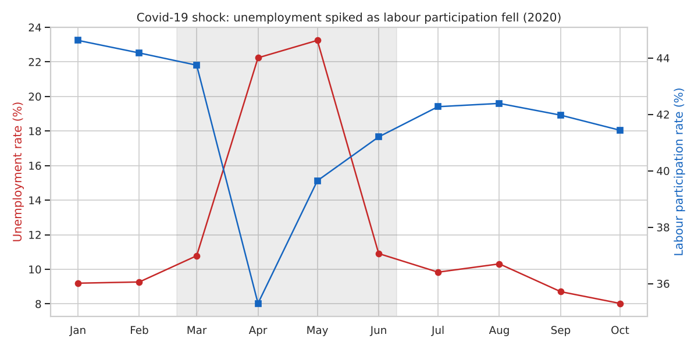
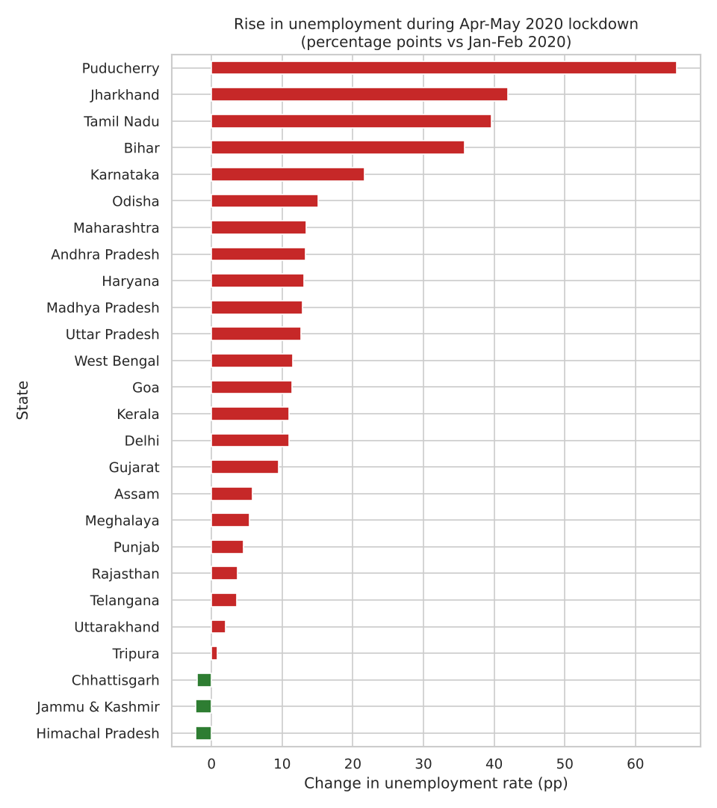
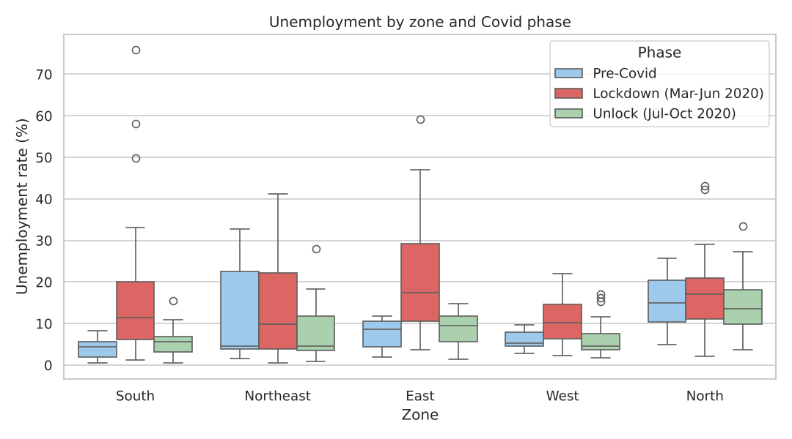
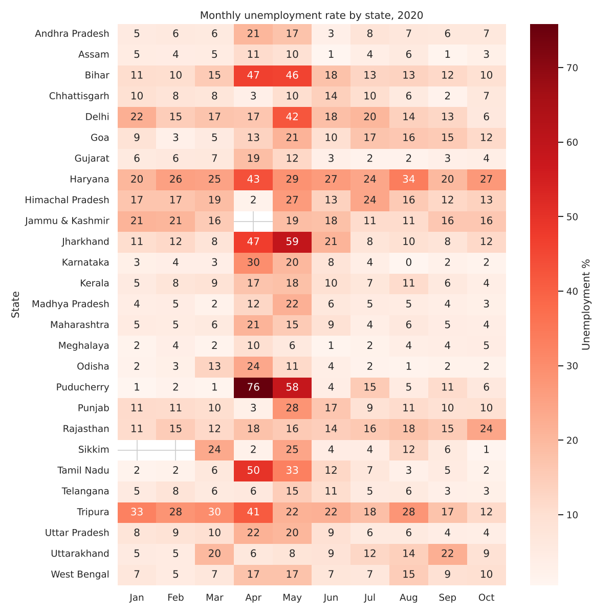

# CodeAlpha_UnemploymentAnalysis

**CodeAlpha Data Science Internship – Task 2**
Author: Rinae Mathaulula

An analysis of unemployment in India from May 2019 to October 2020. It measures the impact of Covid-19 and identifies regional and urban/rural patterns.

## Datasets
| File | Coverage | Rows |
|---|---|---|
| `Unemployment in India.csv` | States, split Rural/Urban, May 2019 – Jun 2020 | 740 |
| `Unemployment_Rate_upto_11_2020.csv` | States with zone and coordinates, Jan – Oct 2020 | 267 |

Each row has the estimated unemployment rate (%), the estimated number employed and the labour participation rate (%). The source is the Centre for Monitoring Indian Economy (CMIE), via Kaggle.

## Data cleaning
- Stripped stray spaces from column names and values, and removed a hidden BOM character.
- Dropped 28 completely empty rows at the end of the first file.
- Converted dates from text (`31-05-2019`) to proper datetimes, labelled by month.
- Checked for missing values and duplicates (none remained).
- Labelled every record with a Covid phase: **Pre-Covid** (before Mar 2020), **Lockdown** (Mar–Jun 2020) and **Unlock** (Jul–Oct 2020).

## Key findings

**1. Covid-19 nearly doubled unemployment.** The average state unemployment rate rose from **9.2% before Covid to 16.7% during lockdown**, peaking at about 23% in May 2020. It fell back to **9.2% during the unlock** months.

| Phase | Avg unemployment (%) | Avg labour participation (%) |
|---|---|---|
| Pre-Covid (Jan–Feb 2020) | 9.23 | 44.40 |
| Lockdown (Mar–Jun 2020) | 16.74 | 40.02 |
| Unlock (Jul–Oct 2020) | 9.22 | 42.02 |

**2. People left the labour force.** Participation dropped from about 44% to about 36% in April 2020 and had not fully recovered by October. Unemployment recovered, but fewer people were working or looking for work.

**3. Urban areas are consistently worse and were hit harder.** Urban unemployment averaged 13.2%, against 10.3% for rural areas, and peaked near 28% in May 2020. Rural employment (agriculture, rural job schemes) acted as a buffer.

**4. The impact varied enormously by state.** Puducherry (+66 percentage points), Jharkhand (+42), Tamil Nadu (+40) and Bihar (+36) were hit hardest. A few states, such as Himachal Pradesh, Jammu & Kashmir and Chhattisgarh, saw almost no rise. Haryana and Tripura had high unemployment even before Covid.

**5. Seasonal pattern.** Before Covid the rate was fairly stable at 8.9–10%, with a slow upward drift from mid-2019 to early 2020. There was no strong seasonal cycle, although 18 months of data is too short to confirm seasonality with confidence.

## Policy implications
- **Target urban relief first** in future shocks, since urban workers lose jobs faster and have no farm work to fall back on.
- **Allocate support by state.** Uniform national measures miss the fact that some states had 5–10× the impact of others.
- **Track labour participation, not just unemployment.** The headline rate recovered while participation stayed low, which hides discouraged workers.
- **Strengthen rural employment schemes**, which appear to have cushioned rural areas.

## Charts






## How to run
```bash
pip install -r requirements.txt
python unemployment_analysis.py
```

## Tools
Python, Pandas, NumPy, Matplotlib, Seaborn
